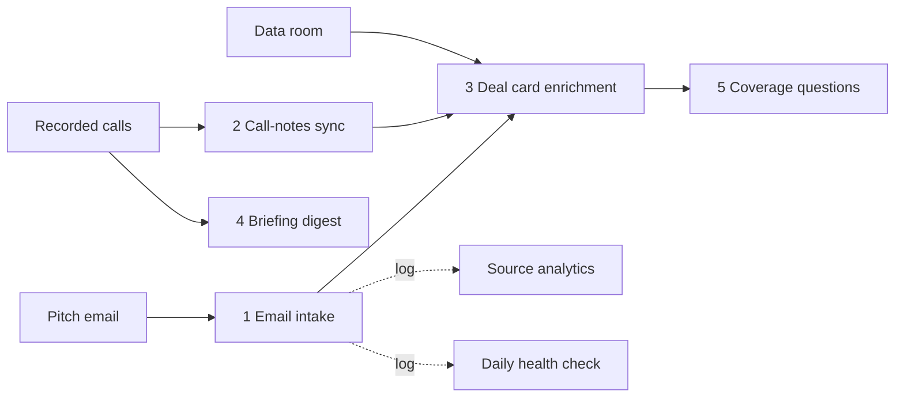
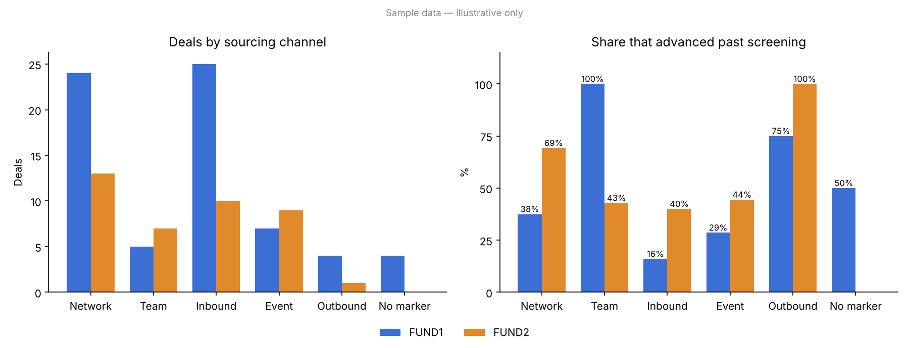

# VC Deal-Flow Automation

Five automations I built for a venture firm with two funds (**FUND1** invests in startups, **FUND2** invests in other funds). Each one fixes a different bottleneck in the team's deal process, and together they run unattended every day.

**Stack:** Google Apps Script · scheduled Claude agents · Gmail · Google Drive & Sheets · Fellow (call recordings) · Notion (CRM) · Python for analytics. Built with Claude as the coding assistant.

  

> Anonymized version. All firm, team, fund and deal names, IDs and links are replaced with placeholders. All data in `sample-data/` is invented. Shared with the firm's permission.

| # | Workflow | Problem it solves |
|---|----------|-------------------|
| 1 | [Email intake](#1-email-intake) | Pitch decks were filed by hand |
| 2 | [Call-notes sync](#2-call-notes-sync) | Call notes never reached the CRM |
| 3 | [Deal card enrichment](#3-deal-card-enrichment) | CRM deal cards went stale |
| 4 | [Briefing digest](#4-briefing-digest) | Next steps from team meetings got lost |
| 5 | [Coverage questions](#5-coverage-questions) | No clear view of what was still unknown about a deal |

Plus: [source analytics](#source-analytics) · [testing & monitoring](#testing-and-monitoring) · [what broke and how I fixed it](#what-broke-and-how-i-fixed-it) · [sample walkthroughs](sample-data/)

---

## Architecture choice

I split the work by its nature:

- **Deterministic, high-volume work → Apps Script.** Parsing emails, moving files, converting PDFs and logging are fast, cheap and fully testable in code.
- **Judgment work → AI agents.** Reading a deck, deciding which deal a call was about, or spotting what changed on a card needs language understanding, so agents do it, under strict written rules about what they may and may not change.



---

## 1. Email intake

**Problem:** Decks arrived by email from many directions. Someone had to download each one, create a folder and log the deal by hand, and nobody tracked where deals came from.

**What I built:** A teammate forwards the email with one line on top, e.g. `FUND1 | Acme | N: Jane Doe`. Every 5 minutes a script creates the deal's Drive folder, saves the email, attachments and linked files, converts DocSend links to PDF, makes searchable OCR copies of scanned decks, and logs the deal, including how it was sourced, in a per-fund sheet.

**Hard problems solved:**
- **DocSend can't be downloaded directly.** Conversion runs through an async queue: a second trigger polls every minute, finds passwords written near the link in the email, and gives up after 5 hours with a clear note.
- **People type the routing line in dozens of ways** (`fund 1 / Acme - Network - Jane`, `FUND I`, look-alike pipe characters, unfilled snippet placeholders). The parser handles them all without breaking names like `A/B Labs` or `Nexus-O`, and anything it can't read is flagged for review rather than lost.
- **Concurrency and re-runs.** A script lock prevents overlapping runs, and a Gmail label plus a message-ID log mean an email is never processed twice.

📄 [`apps-script/intake.gs`](apps-script/intake.gs) · [walkthrough](sample-data/walkthrough/1b-intake-result.md)

---

## 2. Call-notes sync

**Problem:** Founder and GP calls were recorded in Fellow, but the notes stayed there. The CRM had no record of who the team had spoken to.

**What I built:** A daily agent that copies each new call into the right fund's meeting-notes database, with a summary, timestamped topics, action items, the real attendees and the call type.

**Hard problems solved:**
- **Search limits.** Fellow returns at most 20 meetings per search, so the agent searches in weekly slices and splits any slice that hits the cap until the list is provably complete.
- **Late arrivals.** Meetings are often filed weeks after the call, so it rechecks a 30-day window and deduplicates on the recording URL, with a title-plus-date fallback for rows created by hand.
- **Crash safety.** Each page is created with its dedupe key *first* and its content second, so an interrupted run leaves a fixable thin page, never an untracked duplicate.

📄 [`agent-routines/01-call-notes-sync.md`](agent-routines/01-call-notes-sync.md) · [walkthrough](sample-data/walkthrough/2b-meeting-note-result.md)

---

## 3. Deal card enrichment

**Problem:** Deal cards in the CRM were filled in once and then went out of date as calls happened and diligence documents arrived.

**What I built:** An agent triggered by any new deck, call or data-room file. It reads every source for that deal (email, deck, calls, data room) and creates or updates the card through a chain of scoring and one-pager skills, then runs a verification pass and writes a full change log.

**Hard problems solved:**
- **Three independent checkpoints** (sheet rows, call notes, data-room files). Items that can't be matched yet are retried next run, then handed to a human after 7 days, so one bad record can't block the pipeline.
- **Trust levels between sources.** Founders' own statements can update a value; internal discussions and reference calls can only add context. Dates never move backwards, and a vague "end of Q4" is never turned into a fake date.
- **Fields people own are untouchable.** Status, owner, pass decisions and overrides are never changed; if a call suggests one should change, it is reported instead.

📄 [`agent-routines/02-pipeline-enrichment.md`](agent-routines/02-pipeline-enrichment.md)

---

## 4. Briefing digest

**Problem:** In internal pipeline meetings the team agreed next steps on 10+ deals at once. Afterwards nobody had a clean list of who had to do what, and by when.

**What I built:** An agent that recognises these meetings, files them, and emails three digests: the partner's next steps, the analyst's own tasks sorted by due date, and a ready-to-paste prompt for updating next steps in the CRM.

**Hard problems solved:**
- **Mangled names.** Speech-to-text turns company names into near-misses, so every name is matched against the CRM's real deal list (exact → accent-insensitive → phonetic → partial). Uncertain matches are flagged, never guessed.
- **Relative dates.** "Friday" or "tomorrow" is resolved against the date of the call, not the date the agent runs.
- **Prompt-injection defence.** Recaps say things like "email the founders". The agent records these as tasks and never acts on them, and the digest can only go to one hard-coded internal address.

📄 [`agent-routines/03-briefing-sync-and-digest.md`](agent-routines/03-briefing-sync-and-digest.md) · [example email](sample-data/walkthrough/3-briefing-digest-email.txt)

---

## 5. Coverage questions

**Problem:** Before investing, the team needs answers to the same core questions on every deal, but there was no simple way to see which ones were still open.

**What I built:** For every active deal, an agent sets up 12 key diligence questions once, then checks new calls and documents daily and marks questions answered, always with a source.

**Hard problems solved:**
- **Evidence quality.** Founder statements are tagged as self-reported, and conflicts between sources are surfaced rather than silently resolved.
- **Respecting human decisions.** It never reopens an answered question, never touches a dismissed one, and never recreates a deleted one.

📄 [`agent-routines/04-coverage-questions.md`](agent-routines/04-coverage-questions.md)

---

## Source analytics

The intake records how every deal reached the fund. [`analytics/source_analytics.py`](analytics/source_analytics.py) joins that with each deal's current stage to show which channels bring in the deals that actually move forward.



*Chart generated from the fake data in `sample-data/` — illustrative only.* [Full sample report](docs/source-analytics-report.md)

```bash
python3 analytics/source_analytics.py \
  --logs sample-data/deal-log-FUND1-sample.csv sample-data/deal-log-FUND2-sample.csv \
  --outcomes sample-data/deal-outcomes-sample.csv --chart docs/source-analytics.png
```

---

## Testing and monitoring

**94 automated tests** ([`apps-script/tests.gs`](apps-script/tests.gs)) cover the parts with the most edge cases:

| Suite | Cases | What it protects |
|---|---:|---|
| Routing parser | 54 | Every real-world spelling of the routing line, plus names that must not be split |
| Name normalizer | 22 | The company-name matching rule all workflows share ([`normalize.gs`](apps-script/normalize.gs)) |
| Canonical lookup | 5 | Single match, no match, and the "two cards collide → never guess" case |
| Health check | 9 | Alert logic, run against a fixed clock |
| Forwarded email parsing | 4 | Forward chains and the stored email body, incl. a regression test for a bug where a `Cc:` header leaked into the body |

The tests run inside Apps Script (`runAllTests()`) or locally with no Google account:

```bash
node tests/run-tests.js      # ✅ All 94 tests passed.
```

**Daily health check** ([`health-check.gs`](apps-script/health-check.gs)): an automation that fails quietly is worse than none. Every morning it checks that the triggers still exist, that no emails are stuck in NEEDS REVIEW or crashed, and that no DocSend conversion is stuck, and emails an alert only when something needs a human. The checks are a pure function, so they are unit-tested too.

---

## What broke and how I fixed it

| What went wrong | Fix |
|---|---|
| Filtering meetings by title silently dropped most briefings, because real titles were inconsistent and misspelled. | Find meetings by participant pair, then classify by content: "does this sweep the pipeline or go deep on one deal?" |
| The meeting tool's participant list showed the whole team on every call, making every call look internal. | Fetch the real attendee list per meeting and use only people who actually attended. |
| Rows created before the sync existed had no recording link, so they would have been duplicated. | A fallback dedupe key (title + date) next to the primary key. |
| Misheard company names were filing notes under the wrong deal. | Match every name against the CRM's canonical list; flag anything uncertain instead of guessing. |
| A CRM relation in one database pointed at the wrong fund's pipeline. | The agent never writes that field and makes the note easy to file by hand, instead of risking a wrong link. |
| One unmatched call held the checkpoint back, so it was re-checked forever. | Defer for up to 7 days, then hand it to a human in the run report. |

---

## Rules every workflow follows

- **Safe to re-run:** no duplicates, ever.
- **Stops on errors:** it never half-processes data or moves a checkpoint past unread items.
- **Never guesses:** unclear items are flagged for a human.
- **Content is data, not instructions:** a call note saying "email the founder" is recorded, never acted on.

## Impact

- `[X]` decks processed automatically
- `[X]` hours a week of manual data entry removed
- Every active deal card updated within a day of a new call or document

## Repository layout

```
apps-script/
  config.example.gs     settings with placeholders
  intake.gs             workflow 1
  normalize.gs          shared company-name matching
  health-check.gs       daily monitoring
  tests.gs              94 automated tests
agent-routines/         workflows 2–5 (scheduled Claude agents)
analytics/
  source_analytics.py   which sourcing channels produce the best deals
tests/
  run-tests.js          run the Apps Script tests locally with Node
sample-data/            fake data and input → output walkthroughs
docs/                   generated chart and sample report
```
